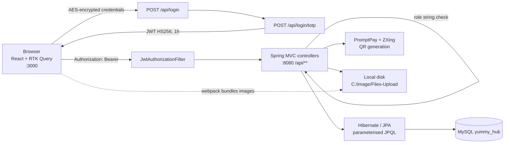
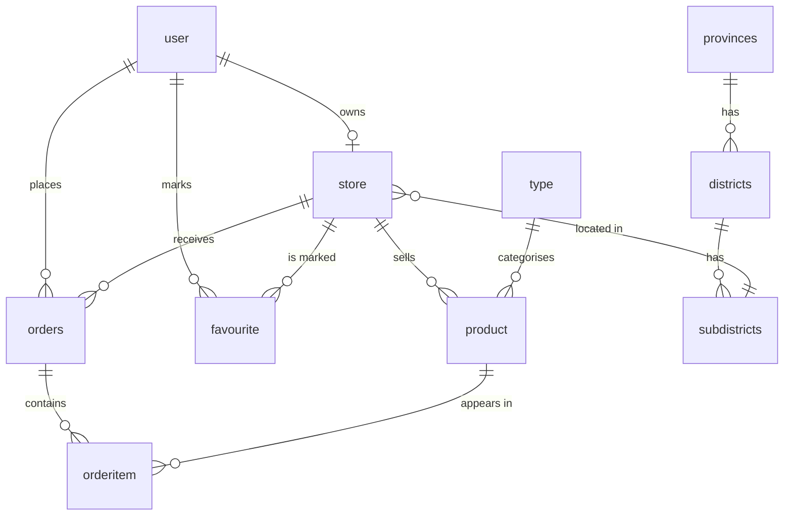

# Yummy Hub

A marketplace where Thai shops list near-expiry food at a discount and customers reserve it, pay by PromptPay QR, and pick it up in store before it goes to waste.

Stack: React 18 + TypeScript, Redux Toolkit / RTK Query, Tailwind CSS, Spring Boot 2.7 (Java 17), Spring Security + JWT, TOTP MFA, Hibernate/JPA, MySQL.

## What it does

| Feature | Who uses it | Where in code |
|---|---|---|
| Browse stores and products by type and location (province / district / subdistrict) | Anyone | `client/src/pages/general/`, `server/.../controller/ProductController.java`, `StoreController.java`, `LocationController.java` |
| Register with mandatory TOTP enrolment (QR for an authenticator app) | Customer | `client/src/pages/authentication/Register.tsx`, `components/ModalMFARegister.tsx`, `server/.../controller/AuthenticationController.java` |
| Two-step login: password, then 6-digit TOTP code, then JWT | All roles | `client/src/store/thunks/userLogin.tsx`, `userLoginMFA.tsx`, `AuthenticationController.java` |
| Cart, favourites, order history | Customer | `client/src/pages/customer/`, `OrderitemController.java`, `FavouriteController.java` |
| Pay: server-generated PromptPay QR, upload transfer slip | Customer | `client/src/pages/customer/Payment.tsx`, `PaymentController.java`, `OrderController.java` |
| Approve or reject payment slips | Administrator | `client/src/pages/administrator/ManagePayment.tsx`, `OrderController.payApprove` |
| Manage own products (create / edit / delete with image) | Store owner | `client/src/pages/store/`, `ProductController.java` |
| Scan customer pickup QR and mark order received | Store owner | `client/src/components/ModalScanner.tsx`, `Html5QrcodePlugin.tsx`, `OrderController.pickup` |
| Nightly job: fail unpaid pickups, purge stale carts | System | `server/.../service/ScheduledService.java` |

## Architecture



The client sends username and password AES-encrypted with `REACT_APP_API_SECRET_KEY`; the server decrypts them with `secret.frontkey`, verifies the salted SHA-256 hash (pepper from `secret.pepper`) and, on success, the client prompts for a TOTP code and calls `/login/totp`, which returns a one-hour HS256 JWT carrying `username`, `firstname`, `lastname` and `role`. The JWT is stored in a cookie and attached as `Authorization: Bearer` by every RTK Query API slice. `SecurityConfig` requires authentication for `/api/auth/**` and leaves the rest of `/api/**` public; `JwtAuthorizationFilter` validates the token and populates the security context. Role-based access is enforced per endpoint inside the controllers by comparing `user.getRole()` against `customer`, `store owner` or `administrator`. All database access goes through Spring Data repositories with named-parameter JPQL `@Query`s, so there is no string-built SQL. Personal fields (`user_id`, `firstname`, `lastname`) are stored AES-encrypted with `secret.backkey`; four wrong passwords or codes lock the account for one hour.

## Repository layout

```
yummy_hub/
  yummy_hub.sql            phpMyAdmin dump: schema + seed data (Thai provinces/districts/subdistricts, sample users, stores, products)
  Diagram.png              ER diagram of the database
  image/Files-Upload/      sample uploaded product and payment-slip images (mirror of C:\image\Files-Upload)
  client/                  Create React App (TypeScript)
    src/pages/             general / authentication / customer / store / administrator screens
    src/store/             Redux store, RTK Query API slices, login thunks and slices
    src/components/        modals (MFA, scanner, payment approval), tables, navbar
    src/utils/             route group wrappers (Anonymous, Customer, Owner, Admin)
    .env                   REACT_APP_API_URL, REACT_APP_API_SECRET_KEY (committed, see Status)
  server/                  Spring Boot 2.7 (WAR packaging, Maven wrapper)
    src/main/java/th/ac/ku/kps/eng/cpe/
      controller/          REST endpoints under /api
      auth/                JwtUtil, JwtAuthorizationFilter
      config/              SecurityConfig
      service/             business logic, Encryption/Decryption/Hash services, nightly scheduler
      repository/          Spring Data CrudRepository interfaces with JPQL queries
      model/, dto/, response/
    src/main/resources/    application.properties, *.hbm.xml Hibernate mappings
```

## Run locally

Prerequisites: Java 17, Maven (wrapper included), Node.js 16+ with npm, MySQL 8 or MariaDB 10.4. The upload path is hardcoded to `C:\image\Files-Upload`, and the client loads images from that same path with `require()`, so a full run currently needs Windows (or edits to `FileUploadUtil.java` and the `require` calls).

```bash
mysql -u root -p -e "CREATE DATABASE yummy_hub CHARACTER SET utf8mb4"
mysql -u root -p yummy_hub < yummy_hub.sql
# edit server/src/main/resources/application.properties: spring.datasource.url / username / password, secret.pepper, secret.frontkey, secret.backkey
cd server && ./mvnw spring-boot:run          # API on http://localhost:8080/api
# edit client/.env: REACT_APP_API_URL=http://localhost:8080/api and REACT_APP_API_SECRET_KEY (base64 AES key matching secret.frontkey)
cd client && npm install && npm start        # UI on http://localhost:3000
```

Copy `image/Files-Upload` to `C:\image\Files-Upload` so seeded product images resolve. CORS is pinned to `http://localhost:3000` on every controller.

## API

All routes are prefixed with `/api`. "Auth" means a Bearer JWT is required by `SecurityConfig`; the role in brackets is checked inside the controller.

| Method | Path | Auth | Purpose |
|---|---|---|---|
| POST | `/register` | no | Validate registration fields and check user id is free |
| GET | `/generateMFACode/{userId}` | no | Generate TOTP secret and QR data URI for enrolment |
| POST | `/register/totp` | no | Verify first TOTP code and create the user (role `customer`) |
| POST | `/login` | no | Step 1: verify encrypted username/password, enforce lockout |
| POST | `/login/totp` | no | Step 2: verify TOTP code, return JWT and user profile |
| GET | `/product`, `/product/{id}`, `/product/type/{id}`, `/product/store/{id}` | no | Public product catalogue |
| GET | `/store`, `/store/{id}`, `/store/{district}/{subdistrict}/{province}` | no | Public store listing and location search |
| GET | `/location`, `/provinces`, `/districts/{id}`, `/type` | no | Reference data |
| GET/POST/PUT/DELETE | `/auth/product[/{id}]` | yes [store owner] | Manage the owner's products (multipart `product` JSON + `file`) |
| GET/POST/PUT/DELETE | `/auth/orderitem[/{id}]`, GET `/auth/cart` | yes [customer] | Cart items |
| POST | `/auth/generatepromptpayqrcode` | yes [customer] | PromptPay QR for the total of the given orders |
| POST | `/auth/payment` | yes [customer] | Upload slip image; reserves stock, order -> Pending |
| GET | `/auth/payment` / PUT `/auth/payment/{id}` | yes [administrator] | List and approve/reject payments; approval issues a pickup code |
| POST | `/auth/generatepickupqrcode` | yes [customer] | QR image of the order's pickup code |
| POST / PUT | `/auth/pickup/check`, `/auth/pickup` | yes [store owner] | Look up a scanned pickup code and mark the order received |
| GET/POST/DELETE | `/auth/favorite[/{id}]` | yes [customer] | Favourite stores |

## Data model

- `user` - encrypted id/name, salted SHA-256 password, `role` enum (`customer`, `store owner`, `administrator`), lockout counters, TOTP secret.
- `store` - one per owner (`user_id`), address, opening hours, location FKs.
- `product` - belongs to a `store` and a `type`; `expiry_date`, `price`, `discount_price`, `quantity_available`, image file name.
- `type` - product category with image.
- `orders` - cart or order per user and store; `order_status` (Cart/Pending/Success/Failed), `payment_status` (Pending/Approve/Reject), slip `filepath`, `pickup_code`, `pickup_status`.
- `orderitem` - line items linking `orders` to `product` with quantity and subtotal.
- `favourite` - user to store bookmarks.
- `provinces`, `districts`, `subdistricts` - Thai administrative areas (Thai and English names, coordinates, zip codes).



## Status

Final-year project at Kasetsart University (Kamphaeng Saen, Computer Engineering). The database dump is from November 2023; the repository was published in 2025. It is complete as a demo and not maintained for production.

Complete: public catalogue, TOTP enrolment and two-step login with JWT, account lockout, cart and favourites, PromptPay QR payment with slip upload, admin approval, pickup QR scanning by store owners, nightly cleanup job.

Known gaps:
- Configuration and secrets (`client/.env`, `application.properties`, signing keys) are committed. They are demo values, but anyone deploying this must rotate them and move everything to environment variables.
- Upload and image paths are hardcoded to `C:\image\Files-Upload`, and the client bundles images with webpack instead of fetching them from the API.
- A few development-only endpoints and helper classes were left in the auth controller; remove them before any real deployment.
- Role checks live in each controller rather than Spring Security authorities, and auth errors surface as HTTP 500 instead of 401/403. No automated tests beyond the generated context-load test.

If I continued it: serve images through a static resource handler, move role checks to `@PreAuthorize`, swap SHA-256 for bcrypt, add store-owner and admin registration flows, and Dockerise the three services.
